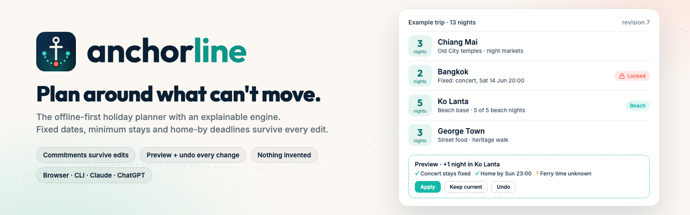
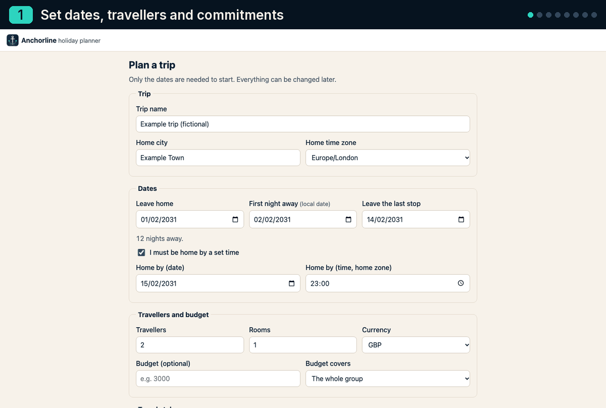
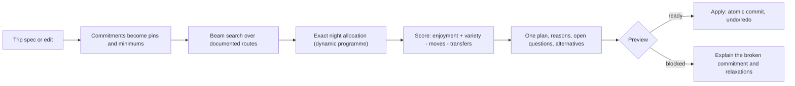

<div align="center">

<picture>
  <source media="(prefers-color-scheme: dark)" srcset="docs/brand/banner-dark.png">
  
</picture>

### Plan around what can't move.

[](https://github.com/IlgazTheFirst/anchorline/actions/workflows/ci.yml)
[](LICENSE)
[](tsconfig.app.json)
[](#data-and-privacy)
[](skills/anchorline/SKILL.md)
[](integrations/README.md)
[](CONTRIBUTING.md)

[Quickstart](#quickstart) · [Use it anywhere](#use-it-anywhere) · [How the engine works](#how-the-engine-works) · [Core workflow](#core-workflow) · [Docs](docs/ALGORITHM.md) · [Contributing](CONTRIBUTING.md)

</div>

Anchorline is an open-source holiday planner for trips with things that can't move: a wedding on the 8th, three nights in Chiang Mai at least, a week on the beach, home by Sunday 23:00. Give it dates, interests and commitments. It recommends one route with its reasons and shows exactly what each edit would change before anything changes. It never invents a booking, a fare or a timetable. It runs in your browser with no account, in your terminal, and inside Claude and ChatGPT through an Agent Skill and an MCP server, all on the same tested engine.

<p align="center">
  
</p>

## Why Anchorline

- **Commitments survive edits.** Fixed events, locked dates, minimum stays, consecutive beach nights and the home-by deadline are hard rules. A change that would break one is blocked and explained, with concrete ways to relax it. Nothing is unlocked for you.
- **Every change is previewed, and undo is real.** You see the stays, nights, journeys, activities, budget and checks that would change, then choose to apply or keep. Undo and redo are new revisions that survive a reload. A second tab can't silently overwrite the first.
- **Nothing is invented.** Planning estimates, sourced facts, quotes you recorded and bookings you made are kept apart. Travel times are ranges, not made-up departures. An unknown price is unknown, not zero. Replacing a city invalidates the old route's evidence.

## Features

| Planning | Editing | Trust | Ownership |
|---|---|---|---|
| One explained route from a real catalogue of 15 places (Thailand, Malaysia, Singapore) | Resize, reorder, replace or add stops, with later stops shifting if you want | Checks marked *met*, *broken* or *unresolved*, with relaxations | Trips live in your browser (IndexedDB) and work offline |
| Beam search plus exact night allocation that keeps every pin and minimum | Your own places anywhere, with name and time zone | Sources and check dates on every place, activity and route | Private backup, import, print |
| A bit of everything by default: food, culture, evenings out, real beach time, downtime | Time-zone-aware journeys, with DST ambiguity resolved explicitly | Suggestions can't mark bookings, quotes or checked timetables | Shareable copy that always drops names, contacts, booking refs and notes |
| Up to three surprises, including short day trips, never on a rest day | Budget lines with price basis, ranges and your own exchange rates | Weekday-only activities flagged if an edit moves them | MIT licensed, no tracking, no paid APIs |

## Use it anywhere

| Surface | Install | Tested |
|---|---|---|
| **Browser** | `git clone https://github.com/IlgazTheFirst/anchorline && cd anchorline && npm ci && npm run dev` | Yes: Playwright journeys at desktop and mobile size, keyboard-only, offline reload |
| **Terminal** | `node skills/anchorline/scripts/anchorline.mjs --help` from a clone (`npx anchorline` once it is on npm) | Yes: Vitest spawns the bundled CLI; CI smoke test |
| **Claude Code plugin** | `/plugin marketplace add IlgazTheFirst/anchorline` then `/plugin install anchorline@anchorline` | Yes: validated, installed from a local marketplace, MCP server **Connected** ([details](integrations/claude-code.md#tested)) |
| **Claude skill** | `cp -r skills/anchorline ~/.claude/skills/` | Partly: format checked against the Agent Skills spec and loaded by the plugin; claude.ai upload not tested |
| **Claude Desktop (MCP)** | Add `node …/skills/anchorline/scripts/anchorline.mjs mcp` to `claude_desktop_config.json` ([guide](integrations/claude-desktop.md)) | Not in Claude Desktop itself; the same stdio server is tested with the MCP SDK client |
| **ChatGPT** | `anchorline mcp --http 8787` behind your own HTTPS URL, added as a developer-mode connector ([guide](integrations/chatgpt.md)) | Not in ChatGPT; the HTTP transport is tested locally |

On Claude Code 2.1.275 or later, the plugin also installs in one step: `/plugin install anchorline --marketplace IlgazTheFirst/anchorline`.

## Quickstart

### Browser

Requires Node.js 20.19 or newer.

```bash
git clone https://github.com/IlgazTheFirst/anchorline
cd anchorline
npm ci
npm run dev            # http://localhost:5173
```

Choose **Start a new trip**, or **Open the fictional demo**. `npm run build && npm run preview` serves the offline-capable production build on http://localhost:4173.

### Terminal

The CLI is one bundled file with no dependencies. Run it from a clone with `node skills/anchorline/scripts/anchorline.mjs`, or put it on your PATH with `npm link`.

```bash
anchorline places
anchorline plan --from London --tz Europe/London --depart 2031-02-01 --nights 14 \
  --home-by 2031-02-16T23:00 --must "chiang mai:3" --beach-nights 5 --out trip.json
anchorline check trip.json
anchorline preview trip.json change.json      # shows the diff, writes nothing
anchorline apply trip.json change.json --out trip-2.json
anchorline export trip.json --share --omit-dates
```

```text
Trip from London: 14 nights, 3 stops: Bangkok 4 · Chiang Mai 5 · Phuket 5.
Style: A bit of everything, balanced pace.
...
Journeys (no times or fares yet)
  London → Bangkok: flight
  Bangkok → Chiang Mai: flight, about 1 h 5 min–1 h 25 min (planning estimate)
  Chiang Mai → Phuket: flight, about 2 h–2 h 20 min (planning estimate)
  Phuket → London: flight
...
Nothing here is booked. Travel times are planning estimates from documented routes, not timetables or fares. Prices are unknown unless you add them.
```

`plan` also reads a JSON trip spec from a file or stdin, and every command takes `--json`. The spec and command formats are in [the skill reference](skills/anchorline/SKILL.md#trip-spec) and [commands.md](skills/anchorline/references/commands.md). Changes are untrusted suggestions unless you pass `--as-user`. Exit codes: `0` ok, `1` bad input, `2` infeasible plan or a broken commitment under `check --strict`.

### Claude Code

```text
/plugin marketplace add IlgazTheFirst/anchorline
/plugin install anchorline@anchorline
```

Then ask: *"Plan 14 nights from London leaving 1 Feb 2031, at least 3 nights in Chiang Mai, 5 beach nights in a row, home by 16 Feb 23:00."* The skill drives the CLI. The MCP tools `plan_trip`, `check_trip`, `preview_change`, `share_export` and `list_places` are available too. See [integrations/claude-code.md](integrations/claude-code.md).

### Claude Desktop and ChatGPT

Both use the MCP server, `anchorline mcp`: over stdio for Claude Desktop, and over streamable HTTP with `--http <port>` for ChatGPT, which needs a public HTTPS URL that you host. See [claude-desktop.md](integrations/claude-desktop.md) and [chatgpt.md](integrations/chatgpt.md), which includes a Custom GPT instruction set.

## How the engine works



Fixed events, locked stays, your own places and protected rest become date pins. A beam search orders stops over a graph of documented connections. A dynamic programme then splits every night exactly, honouring pins, consecutive beach runs and full-day counts. Diminishing returns per night, a variety bonus, and penalties for moves, travel time and airport detours pick one route. The result, like every manual edit, goes through the same validated preview → apply pipeline. Same inputs and catalogue version, same plan. Every constant is in [docs/ALGORITHM.md](docs/ALGORITHM.md).

## Core workflow

Create a trip → edit a stay → preview the impact → apply (saved) → reload → undo. It is automated in [`tests/e2e/core-flow.spec.ts`](tests/e2e/core-flow.spec.ts) at desktop (1440×900) and mobile (390×844) sizes, with made-up inputs.

| Step | Desktop | Mobile |
|---|---|---|
| 1. Create a trip | [desktop](docs/demo/desktop-01-create-trip.png) | [mobile](docs/demo/mobile-01-create-trip.png) |
| 2. Check the summary | [desktop](docs/demo/desktop-02-summary.png) | [mobile](docs/demo/mobile-02-summary.png) |
| 3. Preview the generated plan | [desktop](docs/demo/desktop-03-plan-preview.png) | [mobile](docs/demo/mobile-03-plan-preview.png) |
| 4. Apply it | [desktop](docs/demo/desktop-04-plan-applied.png) | [mobile](docs/demo/mobile-04-plan-applied.png) |
| 5. Edit a stay (+1 night) and preview the impact | [desktop](docs/demo/desktop-05-edit-stay-preview.png) | [mobile](docs/demo/mobile-05-edit-stay-preview.png) |
| 6. Apply (saved, revision 3) | [desktop](docs/demo/desktop-06-applied-and-saved.png) | [mobile](docs/demo/mobile-06-applied-and-saved.png) |
| 7. Reload: still there | [desktop](docs/demo/desktop-07-after-reload.png) | [mobile](docs/demo/mobile-07-after-reload.png) |
| 8. Undo (a new revision, 4) | [desktop](docs/demo/desktop-08-after-undo.png) | [mobile](docs/demo/mobile-08-after-undo.png) |

| Workspace (fictional demo) | A change that would break a commitment | Mobile |
|---|---|---|
|  |  |  |

## Data and privacy

- Trips stay on your device. The web app makes no network requests beyond its own files; the CLI and MCP server make none at all.
- Every accepted change is saved atomically with its undo history. Imports are size-limited and fully validated before anything is written. Only `http(s)` links are kept, and text is never rendered as HTML.
- A shareable copy is built from an allowlist: traveller names and contacts, booking references, private notes and history never leave.

See [SECURITY.md](SECURITY.md) for the full data boundaries.

## Coverage and limitations

- Automatic planning covers the *Thailand & the Malay Peninsula* pack: Bangkok, Ayutthaya, Chiang Mai, Ko Samui, Ko Pha-ngan, Ko Tao, Khao Sok, Phuket, Krabi (Ao Nang), Railay, Ko Lanta, Kuala Lumpur, George Town, Langkawi and Singapore. Sources were checked on 31 October 2026. Anywhere else, add your own places and plan by hand with all checks, budget and export features.
- No timetables, fares, live availability or booking. No maps. Season notes are approximate guidance.

## Roadmap

- More destination packs (contributions welcome, see [docs/DATA_PACKS.md](docs/DATA_PACKS.md))
- Publish the `anchorline` package to npm, and an optional hosted demo
- An optional server-side adapter for dated timetables and quotes, still entering through the preview pipeline as untrusted input
- Multi-region trips across packs

## Contributing

Bug fixes, presets and destination packs are welcome. See [CONTRIBUTING.md](CONTRIBUTING.md) and the [code of conduct](CODE_OF_CONDUCT.md). Please never include anyone's real itinerary, booking references or contact details in issues, fixtures or screenshots.

```bash
npm ci && npm run check && npm run test:e2e
```

## License

[MIT](LICENSE). Data, dependency and font notices are in [NOTICE.md](NOTICE.md); the brand guide is in [docs/brand](docs/brand/README.md).
