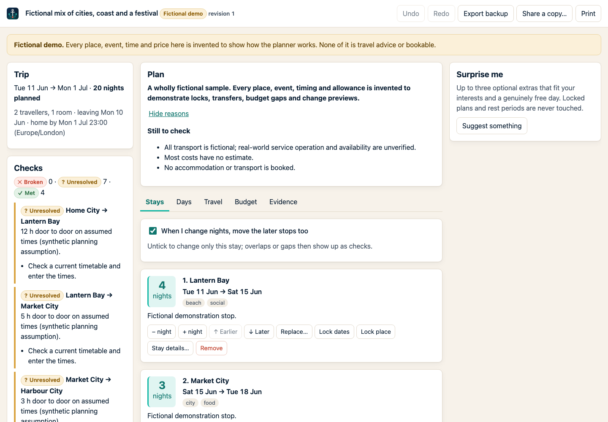
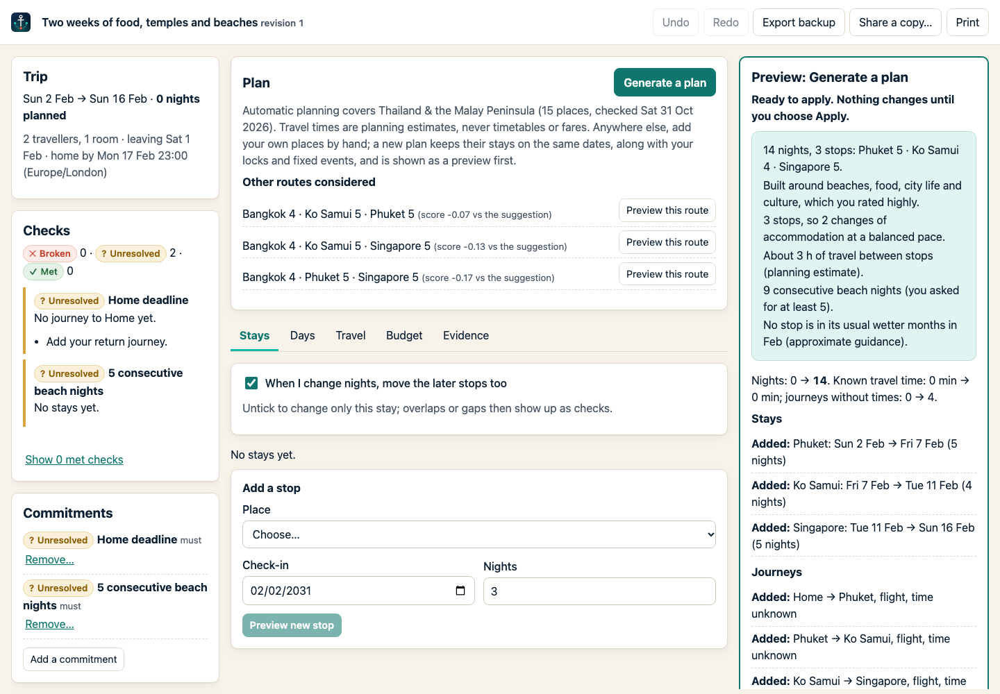
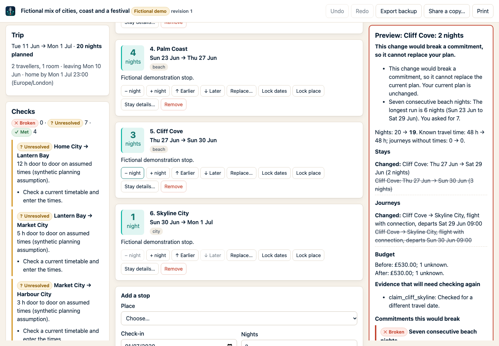
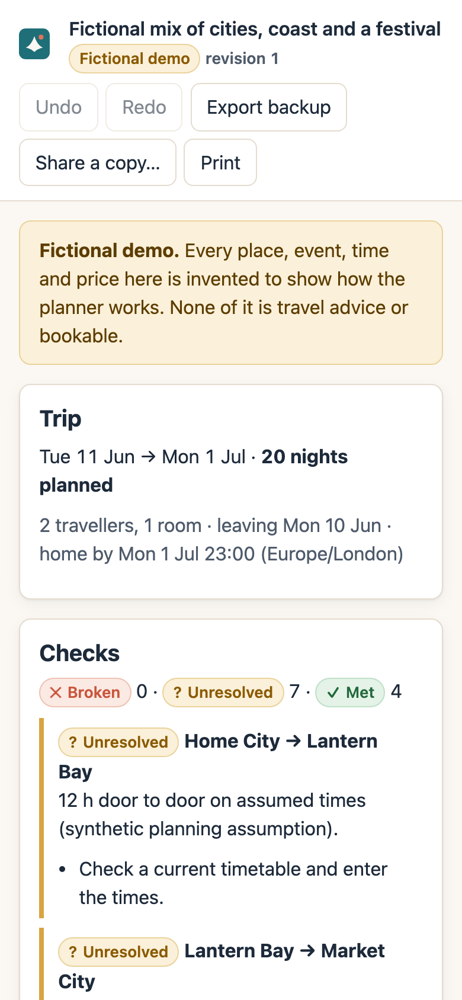

# Anchorline

**Plan around what can't move.**


An open-source, offline-first holiday planner with an explainable planning engine. Start with your dates, travellers, interests and anything that is fixed. It recommends one route with its reasons, shows exactly what every change would do before it happens, and keeps everything in your own browser.

- **Commitments survive edits.** A fixed event, a locked date, seven consecutive beach nights or "home by 23:00" cannot be broken by a suggestion or an edit. A change that would break one is shown, explained and blocked, with concrete ways to relax it. Nothing is ever unlocked for you.
- **Every change is a preview first.** You see the stays, nights, journeys, activities, budget coverage and checks that would change. Then you choose **Apply changes** or **Keep current plan**. Undo and redo survive a reload.
- **It is honest about what it knows.** Planning estimates, documented routes, timetables you checked, quotes and your own booking records are kept separate. An unknown price is never zero. Travel times are ranges, not invented departures. A city swap invalidates the old route's evidence and prices.

No account, no API keys, no tracking, no paid services. It works offline once loaded.



| A generated plan, shown as a preview | A change that would break a commitment | Mobile |
|---|---|---|
|  |  |  |

Screenshots show the fictional demo trip and an example plan generated from made-up inputs.

## Core workflow

Create a trip → edit a stay → preview the impact → apply (saved) → reload → undo. It is automated in `tests/e2e/core-flow.spec.ts`, which captures every step at desktop (1440×900) and mobile (390×844) sizes. All inputs are made up.

| Step | Desktop | Mobile |
|---|---|---|
| 1. Create a trip | [desktop](docs/demo/desktop-01-create-trip.png) | [mobile](docs/demo/mobile-01-create-trip.png) |
| 2. Check the summary | [desktop](docs/demo/desktop-02-summary.png) | [mobile](docs/demo/mobile-02-summary.png) |
| 3. Preview the generated plan | [desktop](docs/demo/desktop-03-plan-preview.png) | [mobile](docs/demo/mobile-03-plan-preview.png) |
| 4. Apply it | [desktop](docs/demo/desktop-04-plan-applied.png) | [mobile](docs/demo/mobile-04-plan-applied.png) |
| 5. Edit a stay (+1 night) and preview the impact | [desktop](docs/demo/desktop-05-edit-stay-preview.png) | [mobile](docs/demo/mobile-05-edit-stay-preview.png) |
| 6. Apply (saved, revision 3) | [desktop](docs/demo/desktop-06-applied-and-saved.png) | [mobile](docs/demo/mobile-06-applied-and-saved.png) |
| 7. Reload: still there | [desktop](docs/demo/desktop-07-after-reload.png) | [mobile](docs/demo/mobile-07-after-reload.png) |
| 8. Undo (a new revision, 4) | [desktop](docs/demo/desktop-08-after-undo.png) | [mobile](docs/demo/mobile-08-after-undo.png) |

## Quick start

Requires Node.js 20.19 or newer (CI uses the version in `.nvmrc`).

```bash
npm ci
npm run dev          # http://localhost:5173
```

Then choose **Start a new trip**, or **Open the fictional demo**.

| Command | What it does |
|---|---|
| `npm run dev` | Development server |
| `npm run build` | Type-check and build the production app into `dist/` |
| `npm run preview` | Serve the production build on http://localhost:4173 (offline-capable) |
| `npm test` | Domain, planner, storage and import/export tests (Vitest) |
| `npm run test:e2e` | Browser journeys against the production build (Playwright). First run: `npx playwright install chromium` |
| `npm run lint` / `npm run typecheck` | ESLint / TypeScript |
| `npm run check` | Typecheck, lint, unit tests and build in one go |
| `npm run check:links` | Check that every source link in the destination packs resolves (needs network) |

## What you can do

1. **Create** a trip with home city and time zone, dates, a home-by deadline, travellers, rooms, currency, budget approach and a travel style. The default preset, **A bit of everything**, means good food, city exploring and culture, social evenings, proper beach time, a little adventure and enough downtime. Every setting is editable, and there are other starting points (Quiet evenings, Slow and easy, Family friendly, Active and outdoors).
2. **Anchor** it: places you must visit (with minimum nights), places to avoid, consecutive beach nights, full beach days, fixed events with an arrival buffer, protected rest. Lock any stay's dates or place and any journey's times.
3. **Generate** a plan inside the bundled region (*Thailand & the Malay Peninsula*, 15 real places). You get stops, nights, journeys with planning-estimate durations, activities on free days, reasons, open questions and alternative routes.
4. **Inspect** it in Stays, Days, Travel, Budget and Evidence views, with checks that are *met*, *broken* or *unresolved*.
5. **Revise**: resize, reorder, replace or remove stops, edit journeys with time-zone-aware times, add activities, budget lines, your own exchange rates, evidence and booking records.
6. **Add your own places**: anywhere outside the catalogue, with a name, time zone and tags. Use them in stays, journeys, activities and commitments. The app says plainly that it has no routes, activities or season notes for them, and a new plan keeps their stays on the dates you chose.
7. **Surprise me**: up to three optional extras, including short day trips, each on a day that still has free time. Never on protected rest or a recovery morning. Same preview as every other change.
8. **Keep** it: saved locally with every revision. Export a private backup (JSON), import it again, print a clean itinerary, or export a **shareable copy** that always leaves out traveller details, booking references, private notes and history. You can also leave out exact dates, accommodation and costs.

## How the planning engine works

In short: commitments become pins and minimums. A beam search explores place orders over a graph of documented connections. A dynamic programme allocates every night exactly, honouring pins, consecutive-night runs and full-day counts. Diminishing returns per night, a variety bonus and penalties for moves, transfer time and airport detours produce one explained recommendation. The full write-up, with every constant, is in **[docs/ALGORITHM.md](docs/ALGORITHM.md)**.

## Date, time and money rules

- A stay is a check-in date and an exclusive check-out date in the destination's calendar. Nights are date differences, so stays across a clock change still count as one night per date.
- Seven consecutive beach nights and seven full beach days are different. Full days exclude arrival, departure and transfer days.
- Journeys use zoned times. A time that happens twice when clocks go back must be disambiguated; a time that never happens is rejected.
- The home deadline is about arriving home after the final transfer buffer, not about when the last flight leaves.
- Money is stored in integer minor units with an explicit currency and price basis (per room-night, per person, per booking…). Multipliers apply once. Ranges are kept. Different currencies are never added together unless you enter a rate.

## Data, privacy and storage

- Trips live in your browser's IndexedDB. Browsers can clear storage, so export a backup of anything important. The app warns you if storage is unavailable.
- Every accepted change is saved atomically together with its undo history. If two tabs edit the same trip, the older change gets a conflict instead of overwriting the newer one.
- Nothing is uploaded, shared or published by the app. "Share a copy" creates a file on your device.
- Imports are size-limited and fully validated before anything is written. Only `http(s)` links are kept, and text is never rendered as HTML.

See [SECURITY.md](SECURITY.md) for the full list of data boundaries.

## Coverage and limitations

- Automatic planning covers the **Thailand & the Malay Peninsula** pack: Bangkok, Ayutthaya, Chiang Mai, Ko Samui, Ko Pha-ngan, Ko Tao, Khao Sok, Phuket, Krabi (Ao Nang), Railay, Ko Lanta, Kuala Lumpur, George Town, Langkawi and Singapore. Elsewhere you can plan by hand, with all checks, budget and export features.
- Travel durations are planning estimates from documented routes, checked on 31 October 2026. There are no timetables, fares or live availability, and no booking.
- No maps. The day and stay views are lists by design. A geographic map would need sourced coordinates and licensed tiles.
- Season notes are approximate guidance, not forecasts.
- There is no AI chat in this release. The command pipeline already validates untrusted proposals, so a future model can only *suggest* changes through the same preview.

## Project layout

```text
src/
  domain/       Schemas (Zod), dates (Temporal), money, constraints, commands, evidence
  planner/      Route graph, scoring, beam search, night allocation, surprises
  application/  Preview/apply pipeline, undo/redo history, import/export, share builder
  storage/      Dexie (IndexedDB) repository with atomic transactions
  catalogue/    Destination pack schema and the bundled real-world pack
  fixtures/     The fictional demo trip
  features/     React screens: home, setup, workspace views
  ui/           Small accessible components and styles
tests/          Vitest (domain, planner, application, catalogue) and Playwright (e2e)
docs/           Algorithm, architecture, data packs, acceptance mapping, release checklist
```

More: [docs/ARCHITECTURE.md](docs/ARCHITECTURE.md) · [docs/DATA_PACKS.md](docs/DATA_PACKS.md) · [docs/ACCEPTANCE.md](docs/ACCEPTANCE.md)

## Contributing

Bug fixes, new presets and new destination packs are welcome. See [CONTRIBUTING.md](CONTRIBUTING.md). Please never include anyone's real itinerary, booking references or contact details in issues, fixtures or screenshots.

## License

Code and documentation: [MIT](LICENSE). Data and dependency notices: [NOTICE.md](NOTICE.md).
